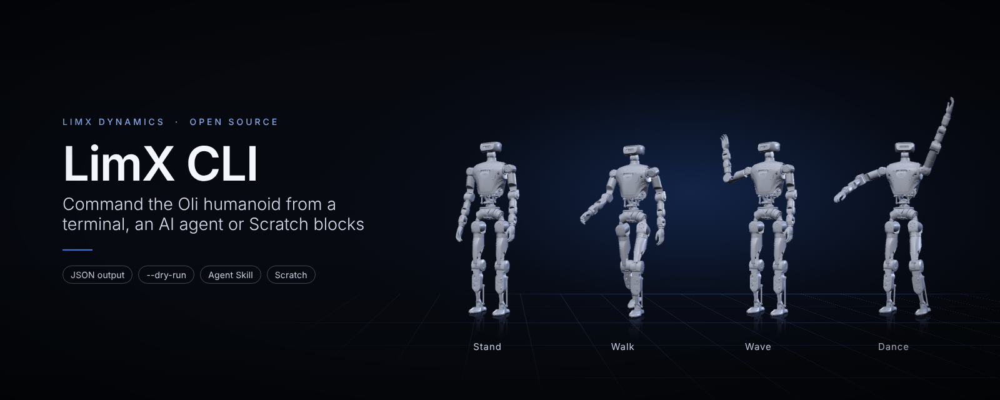
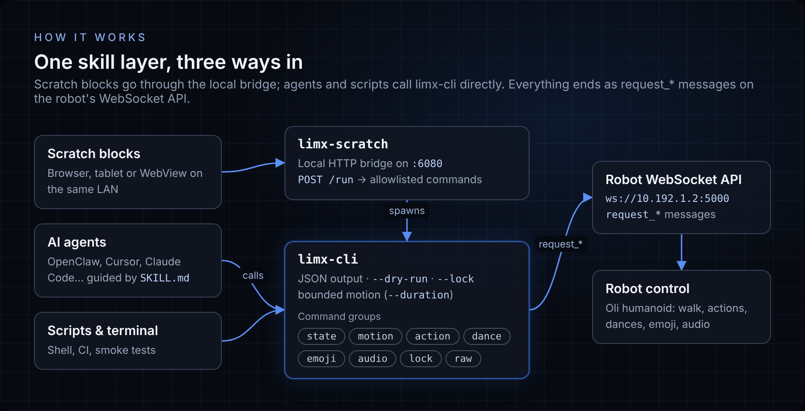
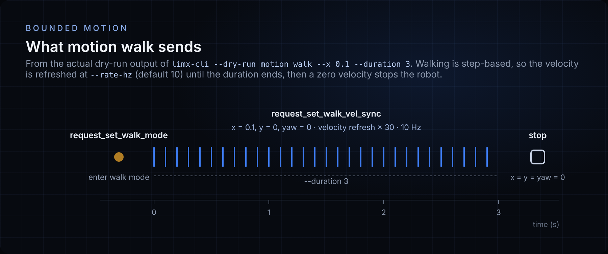

<p align="center">
  
</p>

<p align="center">English | <a href="README_cn.md">中文</a></p>

<p align="center">
  <a href="LICENSE"></a>
  
  
  <a href="https://github.com/limxdynamics/limxdynamics/blob/main/doc/wechat_qr.png"></a>
</p>
<p align="center"><sub>For partnership and procurement inquiries, contact <a href="mailto:opensource@limxdynamics.com">opensource@limxdynamics.com</a></sub></p>

# LimX CLI

LimX CLI is a skill control and orchestration layer built on top of the LimX robot WebSocket API. It wraps the robot's `request_*` control interfaces into two easier-to-use entry points:

- `limx-cli`: a command-line tool for AI Agents, automation scripts, and developers.
- `limx-scratch`: a local service for Scratch visual programming, with the built-in `LimX Robot` block extension.

> Current status: `0.1.0` initial open-source release candidate. The CLI and Scratch bridge are usable for local development and robot smoke tests. Hardware coverage is currently focused on Oli-style workflows; other robot families and production deployment patterns may need additional validation.

## Highlights

- **One command line for the whole robot.** Eight command groups cover state, motion, actions, dances, emoji, audio, the control lock and raw `request_*` calls.
- **Built for agents and scripts.** Every command prints JSON, and the bundled [`SKILL.md`](SKILL.md) teaches OpenClaw, ZeroClaw, Cursor or Claude Code to drive the robot safely.
- **Rehearse before you move.** `--dry-run` prints the exact requests without connecting, and `motion walk` always takes a `--duration` and ends with a zero-velocity stop.
- **Drag blocks instead of typing.** `limx-scratch` serves a Scratch editor with a `LimX Robot` block category, so classrooms and demos can program Oli without code.
- **Copy the bundle and run.** CMake builds an installable bundle that already contains the Node.js runtime, so the target machine needs no system Node.js.

## What you can do

| Group | Subcommands | Example |
| --- | --- | --- |
| `state` | `mode` `joint` `imu` `pose` | `limx-cli state mode` |
| `motion` | `walk` `standup` `sit` `lie-down` `prepare` `zero-torque` `calibrate` | `limx-cli motion walk --x 0.1 --duration 2` |
| `action` | `list` `status` `enter` `exit` `stop` `run` | `limx-cli action run --name wave_greet_bye --timeout 120` |
| `dance` | `list` `enter` `exit` `stop` `run` | `limx-cli dance run --rc-mapping solo_shake --timeout 660` |
| `emoji` | `list` `set` `set-default` `get-default` `delete` | `limx-cli emoji set smile` |
| `audio` | `set-volume` `play-file` `playback` | `limx-cli audio set-volume 60` |
| `lock` | `acquire` `release` `info` | `limx-cli lock info` |
| `raw` | any `request_*` title | `limx-cli --dry-run raw request_get_robot_status` |

The same skills, as Scratch blocks on a real Oli robot:


## How it works

<p align="center">
  
</p>

Typical flow:

1. A user sends a robot skill command through Scratch blocks, CLI, scripts, or an AI Agent.
2. `limx-scratch` converts visual block requests into limited CLI calls.
3. `limx-cli` converts high-level skill commands into WebSocket API `request_*` messages.
4. The WebSocket API forwards the requests to the robot control system.

## Quick start in 30 seconds

No robot and no CMake needed. `--dry-run` shows what would be sent to the robot:

```bash
git clone https://github.com/limxdynamics/limx-cli.git
cd limx-cli
python3 -m venv .venv && . .venv/bin/activate
pip install .
limx-cli --dry-run motion walk --x 0.1 --duration 3
```

When the robot is on the same network, drop `--dry-run` and point the CLI at it:

```bash
limx-cli --host 10.192.1.2 --port 5000 state mode
```

`pip install .` gives you `limx-cli`. The Scratch editor behind `limx-scratch` comes from the CMake bundle described in [Build and install with CMake](#build-and-install-with-cmake).

## Prerequisites

- Linux x86_64 or aarch64.
- Python `>= 3.8`.
- CMake `>= 3.16`.
- Access to the LimX robot WebSocket API. The default address is `ws://10.192.1.2:5000`.
- Building the Scratch static site requires Node.js / npm on the build machine.
- The CMake deployment bundle includes the specified Node.js runtime, so the target machine does not need a system Node.js installation to run `limx-scratch`.

On Ubuntu / Debian:

```bash
sudo apt update
sudo apt install -y build-essential cmake python3 python3-pip curl
```

Install Node.js `22.22.0` with nvm:

```bash
# nvm example
curl -fsSL https://raw.githubusercontent.com/nvm-sh/nvm/v0.39.7/install.sh | bash
. "$HOME/.nvm/nvm.sh"
nvm install 22.22.0
nvm use 22.22.0
node --version
npm --version
```

Python dependency:

```bash
python3 -m pip install websocket-client
```

For development tests:

```bash
python3 -m pip install pytest
```

Full development flow, from tests to the installed bundle:

```bash
cd limx-cli
python3 -m pip install websocket-client pytest
python3 -m pytest tests/ -q

# Run without installing, useful during development.
python3 -m limx-cli.cli --dry-run state mode

# Build and install the copyable runtime bundle.
cmake -S . -B build
cmake --build build
cmake --install build --prefix install
export PATH="$PWD/install/bin:$PATH"

limx-cli --help
limx-cli --host 10.192.1.2 --port 5000 state mode
limx-scratch --listen-host 0.0.0.0 --listen-port 6080
```

Use `--dry-run` before high-risk motion, action, dance, audio, or display changes.

## Build and install with CMake

Build with CMake:

```bash
cd limx-cli
cmake -S . -B build
cmake --build build
```

Install for local testing:

```bash
cmake --install build --prefix install
```

After installation:

- `limx-cli` is installed to `install/bin/limx-cli`.
- `limx-scratch` is installed to `install/bin/limx-scratch`.
- Runtime resources are installed under `install/bin/limx-cli.bin/`.

Use the local installation directory:

```bash
export PATH="$PWD/install/bin:$PATH"

limx-cli --help
limx-scratch --help
```

Install system-wide to `/usr/local`:

```bash
sudo cmake --install build --prefix /usr/local
```

After system installation:

- `limx-cli` is installed to `/usr/local/bin/limx-cli`.
- `limx-scratch` is installed to `/usr/local/bin/limx-scratch`.
- Runtime resources are installed under `/usr/local/bin/limx-cli.bin/`.

## Usage

### Configure robot connection

The default connection is `10.192.1.2:5000`. It can be overridden with command-line arguments:

```bash
limx-cli --host 10.192.1.2 --port 5000 state mode
```

Environment variables can also be used:

```bash
export LIMX_ROBOT_HOST=10.192.1.2
export LIMX_ROBOT_PORT=5000
```

### CLI

Common commands:

```bash
# State queries
limx-cli state mode
limx-cli state joint
limx-cli state imu

# Actions and dances
limx-cli action list
limx-cli action run --name wave_greet_bye --timeout 120
limx-cli dance list
limx-cli dance run --rc-mapping solo_shake --timeout 660

# Motion control
limx-cli motion standup
limx-cli motion walk --x 0.1 --y 0 --yaw 0 --duration 2
limx-cli motion sit

# Emojis and volume
limx-cli emoji list
limx-cli emoji set smile
limx-cli audio set-volume 60
```

`limx-cli` outputs JSON by default, making it easy for Agents and automation scripts to parse:

```bash
limx-cli state mode
limx-cli action list
limx-cli --dry-run motion walk --x 0.1 --duration 3
```

`--dry-run` shows the planned request without controlling the robot. For `motion walk` the plan looks like this:

<p align="center">
  
</p>

### Agent Skill usage

The repository provides `SKILL.md` so OpenClaw, ZeroClaw, Cursor, Claude Code, and other Agent Skill compatible tools can understand how to call `limx-cli` safely.

Usage:

1. Install `limx-cli` following [Prerequisites](#prerequisites) and confirm it is available in the current shell:

```bash
limx-cli --help
```

2. Add `limx-cli/SKILL.md` to the skill directory of the corresponding tool, or reference this file in the tool configuration.

Common locations:

| Tool | Usage |
| --- | --- |
| OpenClaw / ZeroClaw | Place `SKILL.md` in the project or workspace skills directory and let the Agent load it |
| Cursor | Place `SKILL.md` in a Cursor-discoverable skill directory, or open it with the project so the Agent can read it |
| Claude Code | Copy it to `~/.claude/skills/limx-cli/SKILL.md` |

3. Set robot connection environment variables:

```bash
export LIMX_ROBOT_HOST=10.192.1.2
export LIMX_ROBOT_PORT=5000
```

4. Ask the Agent natural-language tasks, for example:

```text
Check the current robot state
List available actions
Plan a dry-run forward walk at 0.1 m/s for 3 seconds
```

`SKILL.md` guides the Agent to prefer JSON output, dry-run high-risk motions first, and use existing CLI subcommands to access robot capabilities.

### Scratch visual programming

Start the Scratch local service:

```bash
limx-scratch
```

To allow phones, tablets, or WebViews on the same LAN to access it:

```bash
limx-scratch --listen-host 0.0.0.0 --listen-port 6080
```

Open the Scratch page address printed by `limx-scratch` in a browser.

The Scratch page shows the `LimX Robot` category. Common blocks include:

- Query robot state.
- Enter stand, walk, damp, and zero-torque modes.
- Run actions and dances.
- Walk for a specified duration with `x/y/yaw`.
- Set emojis and volume.
- Refresh action and dance lists.
- Stop the robot.

Classroom and demo modes can use dry-run:

```bash
limx-scratch --dry-run
```

## Environment variables

| Environment Variable | Default | Description |
| --- | --- | --- |
| `LIMX_ROBOT_HOST` | `10.192.1.2` | WebSocket API host |
| `LIMX_ROBOT_PORT` | `5000` | WebSocket API port |
| `LIMX_SCRATCH_LISTEN_HOST` | `0.0.0.0` | Scratch local service listen address |
| `LIMX_SCRATCH_LISTEN_PORT` | `6080` | Scratch local service listen port |
| `LIMX_SCRATCH_MENU_TIMEOUT` | `5` | Action/dance menu preload timeout |
| `LIMX_SCRATCH_PYTHON` | `python3` | Python executable |

## Tests

Run unit tests:

```bash
cd limx-cli
python3 -m pytest tests/ -q
```

If pytest is not installed:

```bash
python3 -m unittest discover -s tests -v
```

Run robot smoke tests from lower risk to higher risk:

```bash
limx-cli state mode
limx-cli state joint
limx-cli action list
limx-cli dance list
limx-cli --dry-run motion walk --x 0.05 --duration 1
```

## Intended audience

- Robot application developers who need a scriptable interface to the LimX signaling WebSocket API.
- AI Agent tool builders who need a JSON-first, dry-run-friendly robot skill entry point.
- Educators, demo engineers, and operators who want Scratch-style visual programming for robot behaviors.
- Contributors who want to improve the CLI, Scratch bridge, docs, packaging, or tests.

## License

See [LICENSE](LICENSE) and [NOTICE](NOTICE).

## Open Source Notes

LimX CLI provides an easier and more composable entry point for robot skills: AI Agents can call it, developers can script it, and users can build behaviors with blocks.

License notes:

- Except for third-party components, the self-developed parts of LimX CLI are licensed under the Apache License 2.0.
- `scratch-app` is based on Scratch GUI and retains its original GPL-3.0 license notices and copyright information.
- If a release includes `scratch-app` or Scratch pages built from it, the distribution must also comply with GPL-3.0 requirements.

## Scope

It is intended for robot skill inspection, demos, education, automation, and safe agent-assisted operation. It is not a replacement for the robot control stack, firmware, safety controller, or the signaling service itself. It does not provide cloud account management, fleet management, long-running production orchestration, or authorization policy enforcement beyond the robot control lock APIs exposed by signaling.

## Security

Report vulnerabilities privately as described in [SECURITY.md](SECURITY.md). Contribution guidelines are in [CONTRIBUTING.md](CONTRIBUTING.md), and changes are tracked in [CHANGELOG.md](CHANGELOG.md).
